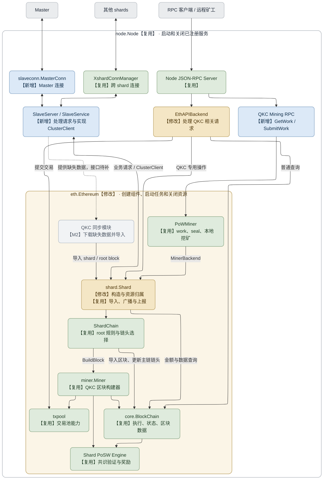
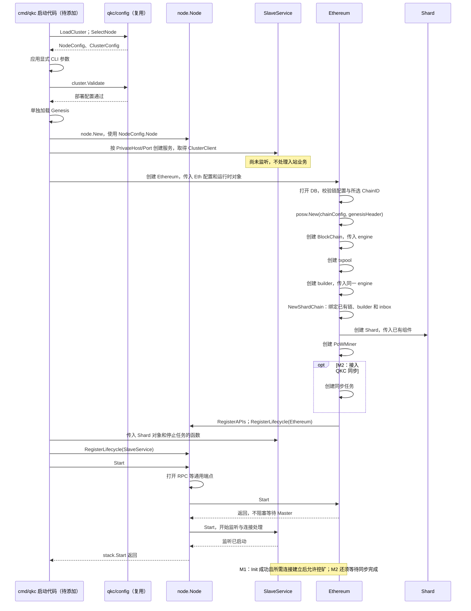
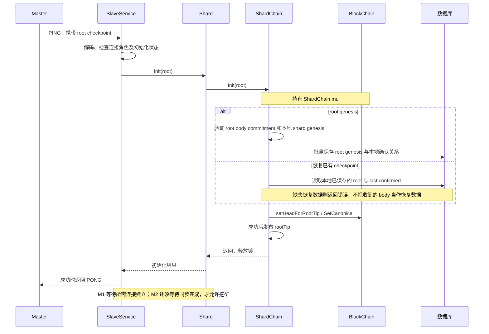
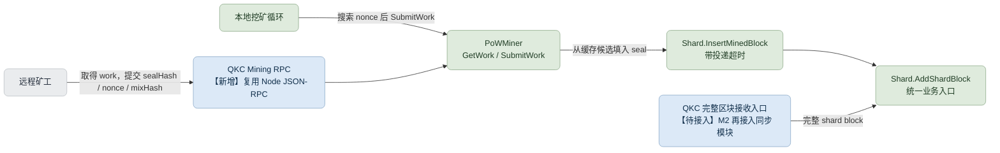
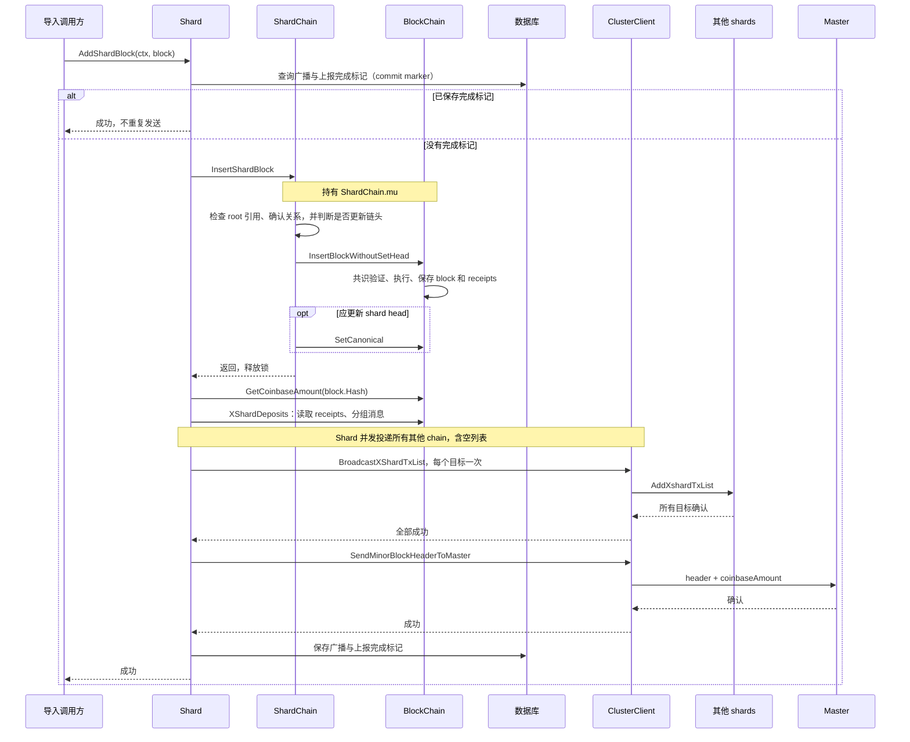
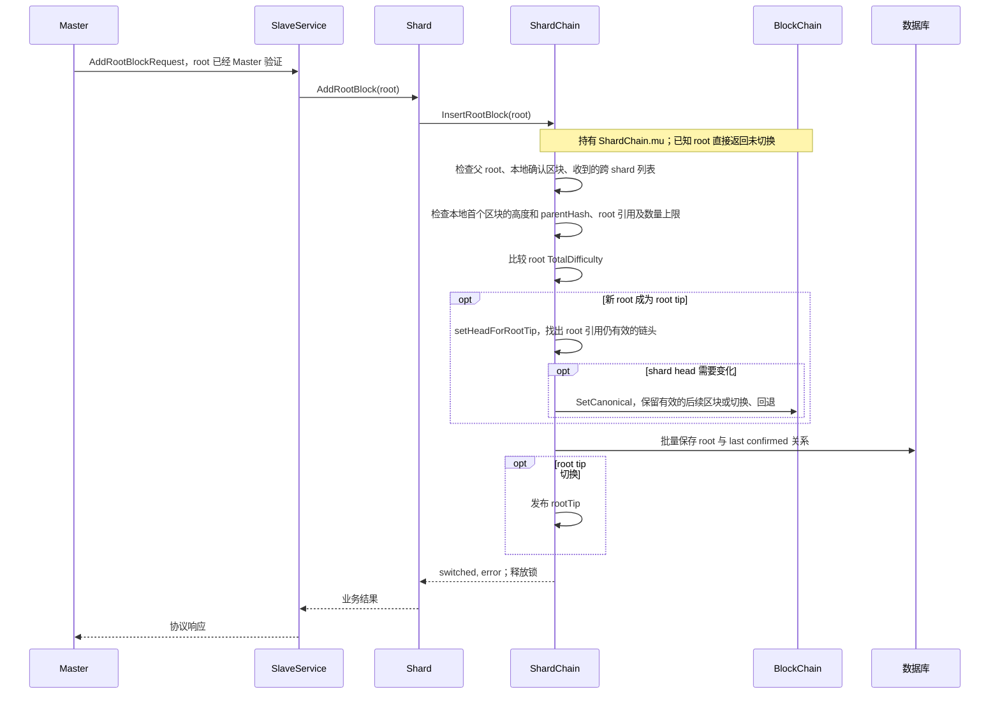

# Shard 与 eth.Ethereum 集成设计

> 状态：设计草案，供 review；已对照 qkc `8e5020cc7` 更新，图中的目标结构尚未全部实现。基于当前单 slave 托管单 chain 的连接模型。
> 范围：Shard backend、ShardChain 与 Ethereum 的集成，复用已有 qkc/config 部署配置。Root chain PoSW 实现、Genesis 文件加载实现和多 chain/slave 拓扑不在本设计中。
> 阶段：QKC 同步模块在 M2 实现，不属于 M1；M1 不创建或等待同步任务，缺失数据直接返回错误。

## 1. 设计结论与模块图

**保留 `Ethereum.blockchain`，由 Ethereum 保存一个 Shard 对象。Shard 负责导入、广播和上报的执行顺序，ShardChain 负责链规则。**

| 必须保持的规则 | 具体要求 |
| --- | --- |
| 一个 BlockChain | Ethereum、ShardChain、builder 共享同一个实例，不重复构造 |
| 明确谁创建和关闭资源 | Ethereum 创建和关闭链、引擎、txpool、builder，启动和停止挖矿；M2 再接入同步任务。SlaveService 创建和关闭监听器及连接 |
| 统一通过 ShardChain 更新链头 | 当前主链的链头（canonical head）和 root tip 由 ShardChain 更新，外部调用不能直接修改它们 |
| 保留普通 geth 行为 | 以下修改和调用限制仅在 QKC 模式生效 |


<details>
<summary>模块图 Mermaid 源码</summary>



</details>

`SlaveServer` 与 `SlaveService` 在此表示同一个组件，不再增加一层。绿色模块只需由启动代码创建，并把对象传给调用它的组件，核心算法不变；例如 QKC 模式不启用 blobpool，由 Ethereum 的初始化分支控制。

`Shard` 标为“修改”是因为其 `New` 改为接收已有的 ShardChain/ClusterClient，链和引擎由 Ethereum 创建和关闭；现有导入、广播、上报和重试流程继续复用。

## 2. 职责、引用与调用位置

| 模块 | 持有/管理 | 业务调用 |
| --- | --- | --- |
| cmd/qkc 启动代码（待添加） | 复用部署配置流程，创建 Node、SlaveService、Ethereum，传入所需对象并注册服务 | 不执行链规则 |
| node.Node | 已注册的 Lifecycle（含 Start/Stop 方法的接口）、JSON-RPC/P2P 基础服务 | 调用 Start/Stop，不处理 QKC 业务 |
| Ethereum | DB、BlockChain、engine、txpool、builder、Shard、PoWMiner；同步任务在 M2 接入 | 统一创建这些组件，并负责启动和关闭 |
| Shard | 使用外部创建的 ShardChain、ClusterClient，不负责关闭它们 | 导入、广播、上报、保存完成标记（commit marker）、处理挖矿请求 |
| ShardChain | 引用同一 BlockChain、builder；维护 root tip/确认关系 | Init、InsertShardBlock、InsertRootBlock、BuildBlock、未确认 headers |
| SlaveService | 监听器、MasterConn、XshardConnManager、Shard 业务接口 | 解析消息，调用对应业务方法并返回响应；实现 ClusterClient |
| RPC 请求处理代码 | 引用业务接口或 PoWMiner | 转换参数和结果，不重复实现导入和重试逻辑 |

**调用示例：**

| 操作 | 目标入口 |
| --- | --- |
| 查询 block、receipt、state、config；订阅链事件 | 现有 BlockChain 查询路径 |
| 提交普通交易 | 现有 txpool 路径 |
| Master 下发 root、查询未确认 headers/stakes | SlaveService → Shard → ShardChain/BlockChain |
| 收到跨 shard deposits | SlaveService → Shard.AddXshardTxList |
| 导入完整 shard block | Shard.AddShardBlock |
| 远程矿工提交 seal | QKC Mining RPC → PoWMiner.SubmitWork |

避免 Go 包互相 import：`eth` 引用 `qkc/shard`；SlaveService 通过 Shard 业务方法接口调用 Shard，Shard 通过 `ClusterClient` 调用通信服务。**通信服务不 import `eth.Ethereum`；cmd 把 Shard 对象传给服务，把 ClusterClient 传给 Shard。**

## 3. 创建、连接和启动组件

**入口选择：** `cmd/qkc` 已有 Master/Slave 角色选择和部署配置；`cmd/geth` 的启动流程更完整，但接入 QKC 需要增加角色和配置分支，并跳过 beacon、Engine API 等默认流程。因此选用 `cmd/qkc`，复用 `cmd/utils`、`node` 和 `eth.Ethereum`。

启动入口放在已有的 [cmd/qkc](/D:/code/src/github.com/ping-ke/modernized-qkc/cmd/qkc/main.go:29)：当前只有 `checkconfig`，尚未创建节点或启动服务，需补充 Slave 的启动流程。参考 [makeFullNode — cmd/geth/config.go:226](/D:/code/src/github.com/ping-ke/modernized-qkc/cmd/geth/config.go:226) 的结构，实际组件创建仍在 [eth.New — eth/backend.go:139](/D:/code/src/github.com/ping-ke/modernized-qkc/eth/backend.go:139) 的 QKC 分支完成。图中的新增方法名为示例，参数和返回值需要在实现前确认。

复用已有 [cmd/qkc 配置处理流程](/D:/code/src/github.com/ping-ke/modernized-qkc/cmd/qkc/config.go:62)：`LoadCluster → SelectNode → 应用显式 CLI 参数 → cluster.Validate`。这只校验部署配置；`GenesisFile` 仅记录路径，不读取 Genesis，也不校验共识规则或链成员。

| 已有配置 | 使用位置 |
| --- | --- |
| `NodeConfig.Node` | `node.New`：数据目录、数据库类型、对外 RPC 等进程设置 |
| `NodeConfig.Eth` | Ethereum：数据库缓存、交易池、builder 等执行设置；仍由 backend 推导 `core.BlockChainConfig` |
| `PrivateHost / PrivatePort` | SlaveService：Master 和其他 shards 使用的内部 TCP 端点 |
| `CoinbaseAddress` | `PoWMinerConfig.Coinbase`：本地挖矿收益地址 |
| `GenesisFile` | 独立的 Genesis 加载流程，结果交给 Ethereum 初始化 |
| `NodeConfig.ChainID`、`ClusterConfig.NetworkID` | 前者选择 shard 进程；后者是独立的正数 `uint64` 网络 ID，部署校验将它写入 `Eth.NetworkId` |

启动时还须校验所选 ChainID 与 Genesis/数据库实际加载的 `ChainConfig.ChainID` 一致，并执行链配置校验。部署中的 `Slaves` 提供进程和地址；广播成员及 root 奖励链以链配置中的 `QuarkChain.ChainIDs` 为准，不能用 `Slaves` 的排列顺序替代。


<details>
<summary>组件创建与启动 Mermaid 源码</summary>



</details>

- [node.Node.RegisterLifecycle:548](/D:/code/src/github.com/ping-ke/modernized-qkc/node/node.go:548) 已满足注册需求，不新增 QKC 字段或 Start 分支。
- [Node.Start:163](/D:/code/src/github.com/ping-ke/modernized-qkc/node/node.go:163) 先打开端点，再按注册顺序启动 Lifecycle。**Ethereum.Start 不能等待排在它后面的 SlaveService 完成握手。**
- BaseConn 同时执行多个 handlers（请求处理函数）。服务层需防止多个 handler 同时修改初始化状态，并检查当前请求是否允许执行；不能假定执行顺序与网络接收顺序相同。
- 创建组件失败时，由创建者关闭已经成功创建的资源。这次只把创建和关闭职责移到对应模块，不改 core 内部创建失败时的处理方式。

## 4. Init shard：Master checkpoint 驱动


<details>
<summary>Init shard Mermaid 源码</summary>



</details>

复用 [Shard.Init:109](/D:/code/src/github.com/ping-ke/modernized-qkc/qkc/shard/backend.go:109)、[ShardChain.Init:156](/D:/code/src/github.com/ping-ke/modernized-qkc/qkc/shard/shardchain.go:156)。不重复上报 genesis header；Master 负责选择恢复 checkpoint。重连不能不加判断地重复调用一次性 Init，应区分首次初始化与后续同步。

| 状态 | 允许的动作 |
| --- | --- |
| 对象已创建、监听已启动 | 握手、建立跨 shard 连接、必要查询；服务保存 Shard 引用并检查请求来源后，可接收 deposit 列表 |
| root 已 Init、正在同步（M2） | 同步模块可调用 Shard 导入缺失区块；矿工请求返回尚未就绪的错误 |
| Init 成功、所需连接已建立；M2 还须同步完成 | 开放 GetWork/SubmitWork、本地挖矿和正常新块入口 |
| 正在停止 | 拒绝新工作，取消并等待已经开始但尚未结束的工作 |

M1 仅支持所需数据已在本地的场景，不自动补齐缺失数据。M2 同步模块导入缺失区块时只要求 root 已 Init，不能要求整轮同步已经完成。接收 deposit 列表也不应等到可以挖矿后才开始。

## 5. 挖矿与完整区块接收：两个入口


<details>
<summary>挖矿与导入入口 Mermaid 源码</summary>



</details>

远程矿工 RPC 的请求处理代码建议放在 `eth/api_qkc_miner.go`，由 [Ethereum.APIs:414](/D:/code/src/github.com/ping-ke/modernized-qkc/eth/backend.go:414) 条件注册。现有 [eth/api_miner.go](/D:/code/src/github.com/ping-ke/modernized-qkc/eth/api_miner.go:27) 没有 PoW GetWork/SubmitWork。

业务参数示例，**不是最终 JSON-RPC 协议**：

```text
qkc_getWork(coinbase)                         → PoWMiner.GetWork
qkc_submitWork(sealHash, nonce, mixHash)      → PoWMiner.SubmitWork
```

业务实现复用 [PoWMiner.GetWork:144](/D:/code/src/github.com/ping-ke/modernized-qkc/qkc/shard/pow_miner.go:144) 和 `SubmitWork`。远程矿工不提交任意完整区块；网络同步入口不依赖本机 work 缓存。

## 6. Add shard block：导入、广播、上报


<details>
<summary>Add shard block Mermaid 源码</summary>



</details>

沿用 [Shard.AddShardBlock:243](/D:/code/src/github.com/ping-ke/modernized-qkc/qkc/shard/backend.go:243) 的顺序和重试规则：任何阶段失败即返回；已入库但没有完成标记的区块仍须重试广播和上报。发送网络 RPC 时已释放 `ShardChain.mu`。区块已入库但上报失败时，链头可能已经前进，重复 SubmitWork 会被当作过期 work 拒绝；后续同步/重试需要按区块 hash 补发。

## 7. Add root block：根据 root 更新 shard 链头


<details>
<summary>Add root block Mermaid 源码</summary>



</details>

复用 [ShardChain.InsertRootBlock:461](/D:/code/src/github.com/ping-ke/modernized-qkc/qkc/shard/shardchain.go:461)。缺少本地 block/deposit 列表时返回错误；M2 由同步层补齐后重试。Root 共识验证仍是 Master 的职责。

现有顺序是先更新 shard head，再保存 root batch。前一步成功、后一步写入失败时，链头可能已经改变。这里沿用已有错误返回和恢复方式，不把两步改成一起成功或一起失败。

## 8. 停止任务与关闭资源

1. `node.Node.Close` 停止外部 RPC，再按注册的相反顺序停止服务。
2. `SlaveService.Stop` 拒绝新连接和业务请求。
3. 调用启动代码传入的停止任务函数，标记正在停止并停止挖矿；M2 另停同步和重试任务。
4. 发出取消通知，等待已开始的请求、区块构建、导入和发送结束。
5. SlaveService 关闭 Master 与跨 shard 连接。
6. `Ethereum.Stop` 关闭交易池、索引、BlockChain 和共识引擎，最后关闭 DB；已经停止的任务直接跳过，资源只关闭一次。

cmd 把 Ethereum 的 QKC 停止方法作为函数参数传给 SlaveService。该方法允许重复调用：已经停止的任务直接跳过，不重复关闭资源，通信服务也不用 import `eth`。`BaseConn.Close` 不取消或等待已经开始的请求处理函数；SlaveService 需要发出取消通知并等待这些请求结束，之后 Ethereum 才能关闭数据库。

## 9. 入口改动清单：仅 QKC 模式

**保留 core 的导入/SetCanonical 方法供 ShardChain 调用；禁止其他运行时调用绕过 ShardChain 直接修改链头。**

| 入口 | 目标行为 | 当前代码位置 |
| --- | --- | --- |
| Engine API：newPayload、forkchoiceUpdated 等 | cmd/qkc 启动流程不注册；不能直接导入、选 head 或设 safe/finalized | geth 参考：[catalyst.Register:52](/D:/code/src/github.com/ping-ke/modernized-qkc/eth/catalyst/api.go:52)、[cmd/geth/config.go](/D:/code/src/github.com/ping-ke/modernized-qkc/cmd/geth/config.go:296) |
| 原生 eth/snap downloader、区块导入调用 | M1 不启用，QKC 同步在 M2 实现。若要继续使用它的交易广播功能，需要确保不会同时启用原有区块导入调用 | [downloader.InsertChain 调用:942](/D:/code/src/github.com/ping-ke/modernized-qkc/eth/downloader/downloader.go:942) |
| simulated beacon、beacon light sync、sync override | cmd/qkc 启动流程不启用 | geth 参考：[cmd/geth/config.go](/D:/code/src/github.com/ping-ke/modernized-qkc/cmd/geth/config.go:296)、[eth/syncer/syncer.go](/D:/code/src/github.com/ping-ke/modernized-qkc/eth/syncer/syncer.go:172) |
| debug_setHead / EthAPIBackend.SetHead | 返回不支持；未来维护操作必须遵守 root 约束 | [EthAPIBackend.SetHead:67](/D:/code/src/github.com/ping-ke/modernized-qkc/eth/api_backend.go:67) |
| admin_importChain、普通 CLI import | 支持 QKC 链规则前拒绝执行；不能直接 InsertChain，也不能按 HasBlock 跳过尚未完成的广播和上报 | [AdminAPI.ImportChain:93](/D:/code/src/github.com/ping-ke/modernized-qkc/eth/api_admin.go:93) |
| ResetWithGenesisBlock 等运行时重置 | 禁止直接绕过 root/确认关系执行 | [Ethereum.ResetWithGenesisBlock:438](/D:/code/src/github.com/ping-ke/modernized-qkc/eth/backend.go:438) |
| pending block/state 构建 | 改用 QKC 构建；未实现前返回不可用，不能改用普通 pending 构建 | [EthAPIBackend.Pending:239](/D:/code/src/github.com/ping-ke/modernized-qkc/eth/api_backend.go:239)、[miner.getPending:145](/D:/code/src/github.com/ping-ke/modernized-qkc/miner/miner.go:145) |
| Blob 交易与 blobpool | 当前 PoSW 不支持：不接入 blobpool，并确认交易入口拒绝 BlobTxType | [Ethereum txpool 初始化](/D:/code/src/github.com/ping-ke/modernized-qkc/eth/backend.go:326) |
| safe/finalized RPC 标签 | 尚未确定它们对应哪些 root 确认状态前，返回不支持；不能直接使用 beacon 的 finality 状态 | [EthAPIBackend.HeaderByNumber](/D:/code/src/github.com/ping-ke/modernized-qkc/eth/api_backend.go:90) |

已有 [NodeConfig.Validate](/D:/code/src/github.com/ping-ke/modernized-qkc/qkc/config/config.go:351) 要求 Slave 关闭外部 P2P，但 Ethereum 仍会创建 handler、注册 eth/snap 协议；配置校验不能代替这里的 backend 分支处理。

禁用 handler/downloader 或 blobpool 后，要一起检查调用它们的方法：`Ethereum.APIs/Start/Stop/Protocols`、`Downloader/Synced/SetSynced/BlobFetcher`、`EthAPIBackend.SyncProgress`。**不能只停止注册协议，却继续调用尚未创建的 handler/blobCache 的方法，否则会发生空指针错误。** 普通 block/state 查询、交易提交和日志订阅尽量保留原有调用。

## 10. 具体实施与 review items

以下是模块级工作清单，不代表已实现，也不展开成逐提交执行计划。

- [ ] **W01 · cmd/qkc 启动代码**：补充 Slave 启动流程，复用现有配置解析、进程选择、CLI 覆盖和部署校验，接入独立的 Genesis 加载结果。创建 stack 和 SlaveService，把 ClusterClient 等运行时对象传给 Ethereum，再把 Shard 对象和停止任务函数传给 SlaveService，注册 Lifecycle。Node 本身不新增 QKC 逻辑；`cmd/geth.makeFullNode` 仅作参考。
- [ ] **W02 · Ethereum 创建组件**：使用已有 `NodeConfig.Eth`，加载并校验实际链配置、核对所选 ChainID。由 `eth.New` 的 QKC 分支调用 `posw.New(chainConfig, genesisHeader)` 创建并持有 Engine，`Ethereum.Stop` 负责关闭。随后创建单个 BlockChain、legacy txpool 和 builder，将同一个 Engine 实例传给 BlockChain 和 builder；再创建 `NewShardChain`、Shard、PoWMiner。不能沿用仅支持 beacon 的 [CreateConsensusEngine](/D:/code/src/github.com/ping-ke/modernized-qkc/eth/ethconfig/config.go:236) 分支。如何传入 ClusterClient 等运行时参数需在 review 时确定；现有普通 geth 调用继续可用。
- [ ] **W03 · Shard 使用已有组件**：调整 [Shard.New:76](/D:/code/src/github.com/ping-ke/modernized-qkc/qkc/shard/backend.go:76)，接收外部创建的 ShardChain/ClusterClient；移除其中的 `posw.New` 和 BlockChain 创建代码，以及 `Shard.Stop` 中的链、引擎关闭逻辑和仅用于关闭的字段。Shard 若无其他清理工作则删除 `Stop`。同步更新职责注释和 TODO，保留 AddShardBlock 的完成标记、广播、上报与重试顺序。
- [ ] **W04 · SlaveService**：建议新增 `qkc/slave/service.go`。实现 Start/Stop、监听和请求处理；检查是否允许挖矿、是否正在停止；取消并等待已开始的请求。实现 `shard.ClusterClient`，并把现有 `slaveconn.XshardHandler` 收到的请求转换成 Shard 方法调用。
- [ ] **W05 · Master 连接**：建议新增 `qkc/slaveconn/master_conn.go`。复用 BaseConn/wire，处理 Ping/Init、ConnectToSlaves、AddRootBlock、header 上报及查询。复用现有 XshardConnManager，保留已登记跨 shard 连接异常断开时的 shutdownSlave 策略；遵守当前 Master 逐个请求建立连接的协议顺序。
- [ ] **W06 · 补齐消息与错误转换**：新增未确认 headers 查询等缺失 wire 消息及 handlers。对带 ErrorCode 响应的业务 RPC，业务失败编码为 response.ErrorCode；非 nil handler error 会关闭连接。Ping/Pong 没有 ErrorCode，Init 失败按握手失败处理，不能返回成功 PONG。沿用已有 Data 内层编码约定；更新生成代码及对应已有测试。
- [ ] **W07 · 远程矿工 API**：建议新增 `eth/api_qkc_miner.go`，按模式注册并调用现有 PoWMiner。Init 或所需连接尚未完成时返回明确错误；M2 再增加同步就绪检查。不新建一套 RPC server。
- [ ] **W08 · QKC 同步入口（M2，不属于 M1）**：新增同步任务及数据获取接口，补齐所需 shard blocks、roots 和 deposit 列表；经 Shard 导入。同步具体请求/来源协议在 M2 明确，不能把“原生 geth sync 已禁用”当作“QKC 同步已实现”。
- [ ] **W09 · 禁止绕过 ShardChain 的调用**：逐项核对第 9 节。尤其检查调用 handler/Downloader/SyncProgress 的地方、pending 构建和 BlobTxType；验证普通 geth 分支保持原行为。
- [ ] **W10 · 停止顺序与资源关闭**：按第 8 节执行停机顺序；等待已开始的请求处理、构建、导入结束后再关资源，外部共享 ClusterClient 不由 Shard 关闭。
- [ ] **W11 · 必要验证**：优先扩展现有测试，覆盖：所选 ChainID 与实际链配置不匹配时拒绝启动；同一链和 builder 对象被共用；Init 前拒绝挖矿但允许握手和 deposit 接收，M2 再补同步场景；本地挖矿、远程矿工和网络完整区块三种来源；没有完成标记时重试；关闭时等待已开始的调用；危险入口在 QKC 模式被拒绝、普通 geth 行为不变；handler/blobpool 未创建时不发生空指针错误。避免重复搭建链测试环境。

### 实现前需要确认的问题

| 待确认 | 为什么影响实现 |
| --- | --- |
| 远程矿工 API 名称、参数编码及旧矿工兼容要求 | 决定 QKC Mining RPC 的对外协议；本文 `qkc_getWork` 等只是示例 |
| QKC 同步从哪里取数据、使用哪些请求、何时算同步完成（M2） | 决定 W08 及 M2 的挖矿就绪条件，不阻塞 M1；不能直接使用 geth handler 的 synced 标记 |
| 如何把 ClusterClient 传给构造函数 | 决定 `eth.New` 的具体修改；ClusterClient 是程序启动时创建的对象，不写入配置文件 |

代码链接指向当前本地工作区，代码修改后行号可能变化。图的 Mermaid 源码保留在各节折叠区，修改时同步更新对应 SVG。本文仅记录设计，不修改业务代码、不引入项目依赖。
