# Shard 与 eth.Ethereum 集成设计

> 状态：设计草案，供 review；已对照 qkc `8e5020cc7` 更新，图中的目标结构尚未全部实现。基于当前单 slave 托管单 chain 的连接模型。   
> 定位：整体集成设计，明确模块职责、归属和主要调用流程；接口细节由各模块后续设计确定。  
> 范围：Shard backend、ShardChain 与 Ethereum 的集成，复用已有 qkc/config 部署配置。Root chain 实现、Genesis 文件加载实现和多 chain/slave 拓扑不在本设计中。   
> 阶段：QKC 同步模块在 M2 实现，不属于 M1；M1 不创建或等待同步任务，缺失数据直接返回错误。

## 总览

- **背景与动机**：Shard、ShardChain 和 PoSW 已具备链业务能力，但尚未接入 geth 的统一启动流程。当前 `Shard.New` 与 `eth.New` 各自创建链和共识引擎，集成需要统一资源归属，并确保 geth 的链头更新入口遵守 ShardChain 的 root 约束。
- **集成方案**：以 `cmd/geth` 为入口，复用 Node 的生命周期和 JSON-RPC，由 Ethereum 统一装配、启动和关闭链与通信组件。保留 Shard 的导入、广播和上报流程，以及 ShardChain、BlockChain、PoSW 各层职责。
- **集成目标**：使用 `cmd/geth` 启动 QKC shard 节点，通过 SlaveService 接收 Master 请求完成初始化，支持本地挖矿和远程矿工接入，并复用查询、交易提交等已有能力。QKC 链更新请求统一通过 Shard，普通 geth 模式保持原行为。同步模块在 M2 接入。

## 1. 要求和模块图

### 集成要求

1. **复用已有架构与流程**：将 QKC 组件接入 geth，沿用已有实现和管理方式。
   - 复用 geth 的启动、数据库、RPC、交易池和区块构建流程，以及现有 Shard、ShardChain 和 PoSW 实现。
   - **沿用 Ethereum 管理组件和资源的方式**，将链、共识、挖矿及通信组件纳入统一的创建、装配、启动和关闭流程；构造失败时清理已创建的资源，借用方不重复关闭。
   - **沿用 Node 管理 Ethereum 生命周期的方式**，由 Ethereum 管理内部 SlaveService；SlaveService 不单独注册到 Node，Node 不增加 QKC 业务逻辑。
2. **明确各层职责**：Shard 协调导入、广播和上报；ShardChain 负责 root 约束、确认关系和链头选择；BlockChain 负责执行与状态；PoSW 负责共识与奖励；SlaveService 负责集群通信。
3. **统一链业务入口**：QKC 模式的初始化、shard/root 区块导入及链头变更请求统一经 Shard 处理，再由 ShardChain 维护 canonical head、root tip 和确认关系；其他运行时入口不能绕过 Shard 直接修改链状态。
4. **控制改动并保持兼容**：修改集中在 QKC 分支和专用方法、文件中，普通 geth 行为保持不变，不做无关重构。

### 当前实现与集成后的变化

下表对比 geth 原有流程和组件，以及接入 QKC 后需要新增或调整的部分。

本文将 `miner.Miner` 称为 **builder（区块构建器）**，负责构建候选区块；**PoWMiner** 负责管理挖矿任务、对接远程矿工和本地挖矿，两者由 Ethereum 创建和持有。

| 方面 | 当前 geth | QKC 集成后新增或调整 |
| --- | --- | --- |
| 启动接入 | `cmd/geth` 创建 Node 和 Ethereum，由 Node 启动已注册服务 | `cmd/geth` 接入 QKC 配置，将配置和 Genesis 加载结果交给 Ethereum；沿用 Node 启动流程 |
| 组件与资源归属 | Ethereum 创建并持有 DB、BlockChain、共识引擎、txpool 和 builder | Ethereum 保留原有资源管理职责，共识引擎使用 PoSW Engine；新增持有 ShardChain、Shard、PoWMiner 和 SlaveService，并完成接口绑定。这些组件共用已有 BlockChain、txpool 和 builder，借用方不重复创建或关闭资源 |
| 生命周期 | Node 管理 Ethereum 的生命周期，Ethereum 负责启动和关闭内部组件及数据库 | 保持 Node 管理 Ethereum 生命周期的流程，将新增的 SlaveService 和挖矿任务纳入 Ethereum 的启动、就绪后启用及停机流程 |
| 链业务与共识 | Ethereum 装配执行组件；BlockChain 负责区块验证、执行和状态，共识实现通过 `consensus.Engine` 接口接入 | Ethereum 和 BlockChain 的职责保持不变；接入 Shard 协调导入、广播和上报，ShardChain 维护 root 约束、确认关系和链头选择，PoSW Engine 负责共识与奖励；SlaveService 实现 ClusterClient，转发集群请求 |
| 链状态更新 | 同步、Engine API 和管理接口等入口直接调用 BlockChain 导入区块或修改链头 | QKC 模式统一通过 Shard 接收链更新请求，由 Shard 调用 ShardChain 完成导入和链头更新；禁止其他运行时入口绕过 Shard |
| RPC 与兼容性 | Node 提供 JSON-RPC；EthAPIBackend 支撑查询、交易提交和订阅，MinerAPI 提供矿工设置接口 | 复用普通查询和交易提交路径，QKC 专用操作调用 Shard；扩展 MinerAPI 对接 PoWMiner。修改集中在 QKC 分支，普通 geth 行为保持不变 |

### 目标模块图

**模块图颜色图例：灰蓝底＝新增；米黄底＝修改/扩展；灰绿底＝直接复用；浅灰底＝外部组件或 M2 后续工作（以框中文字区分）。** 框中的【新增】【修改】【复用】与底色对应。

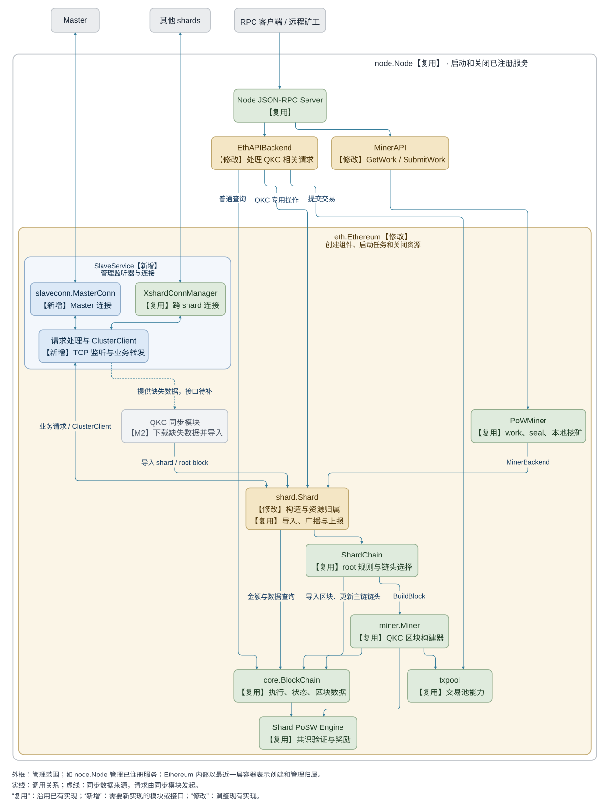

<details>
<summary>模块图 Mermaid 源码</summary>

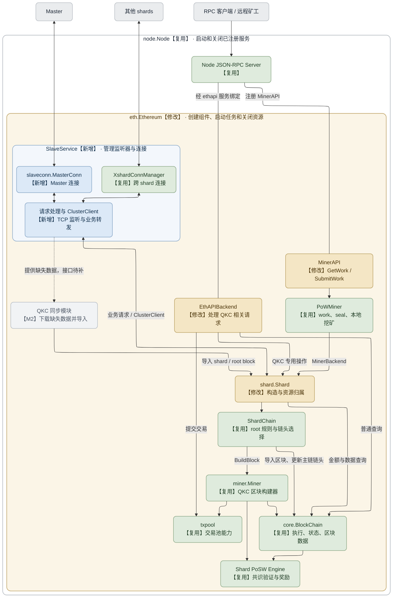

</details>

`SlaveService` 由 Ethereum 创建和管理，包含 TCP 监听器、MasterConn 和 XshardConnManager，并实现 Shard 使用的 `ClusterClient` 接口。ClusterClient 仅表示通信接口，不是独立组件。

EthAPIBackend 和 MinerAPI 同样由 Ethereum 创建和持有。MinerAPI 直接注册为 Node 的 RPC service；EthAPIBackend 供现有 ethapi RPC 服务使用，由这些服务接入 Node JSON-RPC Server。

`Shard` 标为“修改”是因为其 `New` 改为接收已有的 ShardChain/ClusterClient，链和引擎由 Ethereum 创建和关闭；现有导入、广播、上报和重试流程继续复用。

## 2. 职责、引用与调用位置

| 模块 | 持有/管理 | 业务调用 |
| --- | --- | --- |
| cmd/geth 启动代码 | 加载配置，创建 Node 和 Ethereum，传入配置与 Genesis 加载结果 | 不执行链规则，不装配 Shard 与 SlaveService 的互相引用 |
| node.Node | 已注册的 Lifecycle（含 Start/Stop 方法的接口）、JSON-RPC/P2P 基础服务 | 调用 Start/Stop，不处理 QKC 业务 |
| Ethereum | SlaveService、DB、BlockChain、ShardChain、PoSW Engine、txpool、builder、Shard、PoWMiner；同步任务在 M2 接入 | 统一创建、绑定接口、启动和关闭；SlaveService 不单独注册 Lifecycle |
| Shard | 使用外部创建的 ShardChain、ClusterClient，不负责关闭它们 | 导入、广播、上报、保存完成标记（commit marker）、处理挖矿请求 |
| ShardChain | 引用同一 BlockChain、builder；维护 root tip/确认关系 | Init、InsertShardBlock、InsertRootBlock、BuildBlock、未确认 headers |
| SlaveService | 监听器、MasterConn、XshardConnManager、Shard 业务接口 | 解析消息，调用对应业务方法并返回响应；实现 ClusterClient |
| EthAPIBackend | 引用 Ethereum，访问其 BlockChain、txpool 和 Shard | 复用普通查询、交易提交和订阅路径；QKC 专用操作调用 Shard |
| MinerAPI | 引用 Ethereum，使用其 builder 和 PoWMiner | 保留已有矿工设置接口；新增 GetWork / SubmitWork，转发到 PoWMiner |

**调用示例：**

| 操作 | 目标入口 |
| --- | --- |
| 查询 block、receipt、state、config；订阅链事件 | 现有 BlockChain 查询路径 |
| 提交普通交易 | 现有 txpool 路径 |
| Master 下发 root、查询未确认 headers/stakes | SlaveService → Shard → ShardChain/BlockChain |
| 收到跨 shard deposits | SlaveService → Shard.AddXshardTxList |
| 导入完整 shard block | Shard.AddShardBlock |
| 远程矿工提交 seal | MinerAPI → PoWMiner.SubmitWork |

避免 Go 包互相 import：`eth` 引用 `qkc/shard` 和通信服务包；SlaveService 通过 Shard 业务方法接口调用 Shard，Shard 通过 `ClusterClient` 调用通信服务。**由 Ethereum 创建 SlaveService，将其作为 ClusterClient 传给 Shard，再将 Shard 业务接口绑定到服务；全部绑定完成后才开始监听。通信服务不 import `eth.Ethereum`。** TCP 长连接由 SlaveService 自己管理，不接入 JSON-RPC Server。

## 3. 创建、连接和启动组件

**入口选择：** 确定使用 `cmd/geth`。

主要修改 [cmd/geth/config.go](../cmd/geth/config.go) 中的 `makeConfigNode`（第 166 行）和 `makeFullNode`（第 226 行），实际组件创建仍在 [eth.New — eth/backend.go:139](../eth/backend.go) 的 QKC 分支完成。图中的新增方法名为示例，参数和返回值需要在实现前确认。

启动时还须校验所选 ChainID 与 Genesis/数据库实际加载的 `ChainConfig.ChainID` 一致，并执行链配置校验。

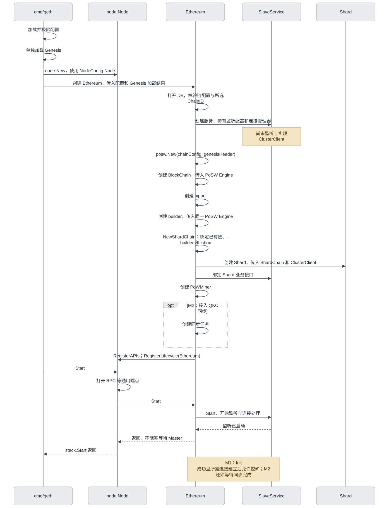

<details>
<summary>组件创建与启动 Mermaid 源码</summary>

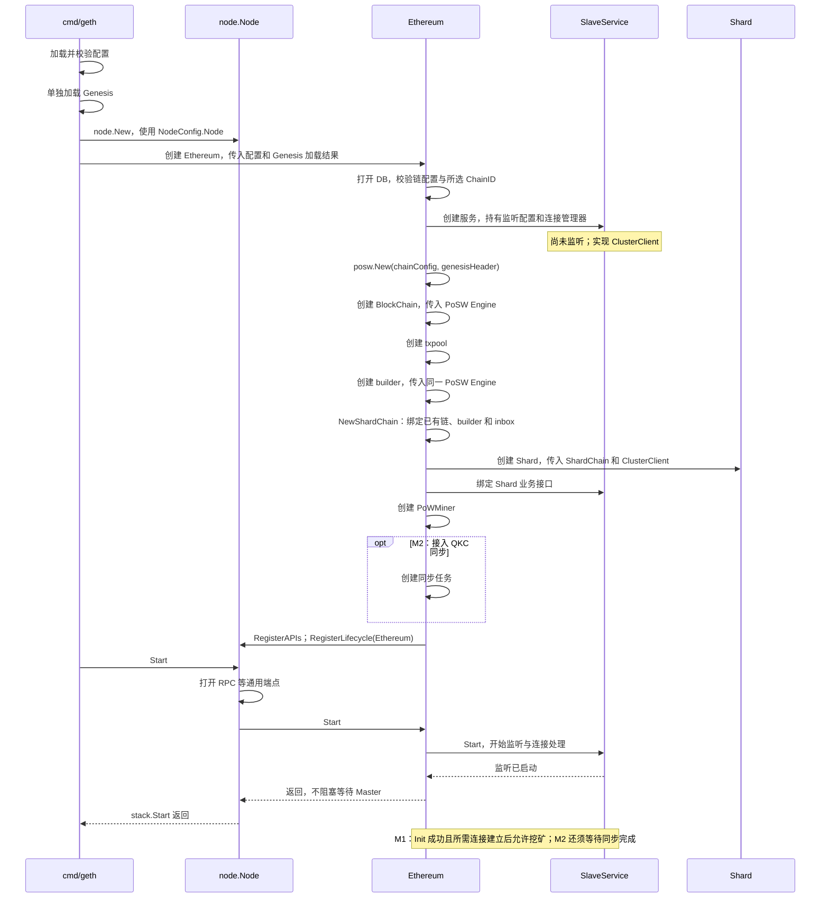

</details>

- [Node.Start:163](../node/node.go) 先打开端点，再启动 Lifecycle。Ethereum.Start 启动内部 SlaveService，但不等待 Master 握手或 Init 完成；未就绪时拒绝挖矿请求。
- 创建组件失败时，由创建者关闭已经成功创建的资源；Ethereum.Start 失败也需回收本次已启动的组件，Node 不会对启动失败的 Lifecycle 调用 Stop。这次不改 core 内部创建失败时的处理方式。

## 4. Init shard：Master checkpoint 驱动

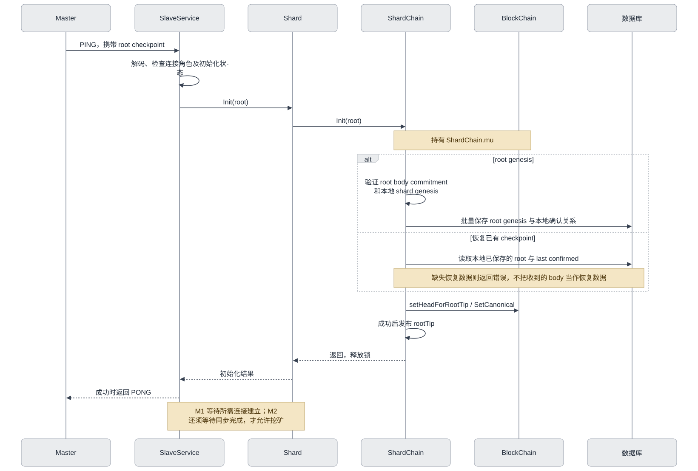

<details>
<summary>Init shard Mermaid 源码</summary>

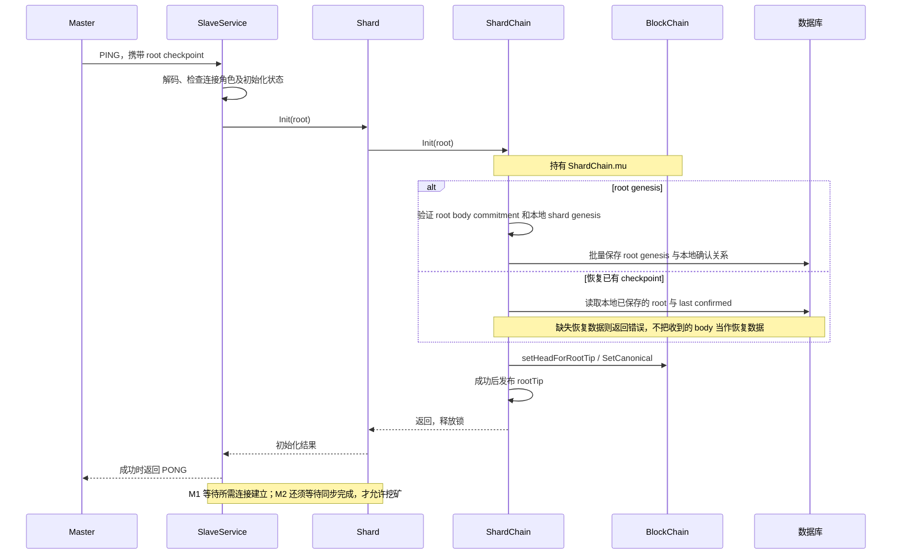

</details>

复用 [Shard.Init:109](../qkc/shard/backend.go)、[ShardChain.Init:156](../qkc/shard/shardchain.go)。不重复上报 genesis header；Master 负责选择恢复 checkpoint。

### QKC 业务就绪条件

Ethereum 协调各组件的生命周期，各业务入口根据初始化、连接、同步和停止状态决定是否接受请求。具体检查位置由各模块后续设计确定。

| 节点状态 | 业务入口限制 |
| --- | --- |
| 已开始监听，尚未完成准备 | 允许握手、建立跨 shard 连接、必要查询和接收 deposit 列表；不允许挖矿 |
| root 已 Init、正在同步（M2） | 允许同步模块通过 Shard 导入缺失区块；矿工请求返回尚未就绪的错误 |
| Init 成功、所需连接已建立；M2 还须同步完成 | 开放 GetWork/SubmitWork、本地挖矿和正常新块入口 |
| 正在停止 | 拒绝新任务，取消并等待在途请求和任务结束后再关闭资源 |

启用本地挖矿时，由 Ethereum 在满足上述就绪条件后启动 PoWMiner。

## 5. 挖矿与完整区块接收：两个入口

两类入口分别是挖矿结果提交和完整区块导入。本地与远程挖矿共用前者，M2 同步模块使用后者。

**挖矿入口图颜色图例：米黄底＝修改/扩展；灰绿底＝直接复用；浅灰底＝外部组件或 M2 后续工作（以框中文字区分）。**


<details>
<summary>挖矿与导入入口 Mermaid 源码</summary>

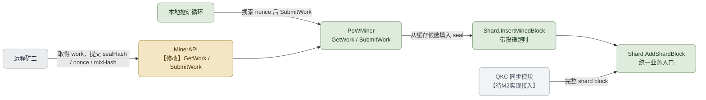

</details>

复用现有 [MinerAPI — eth/api_miner.go](../eth/api_miner.go)，增加 `GetWork`、`SubmitWork`，通过 Node JSON-RPC 转发到 PoWMiner：

```text
MinerAPI.GetWork    → PoWMiner.GetWork
MinerAPI.SubmitWork → PoWMiner.SubmitWork
```

业务实现复用 [PoWMiner](../qkc/shard/pow_miner.go)。远程矿工提交已取得 work 的 seal，完整区块由同步入口接收。接口参数、编码和注册细节由该模块的后续设计确定。

## 6. Add shard block：导入、广播、上报

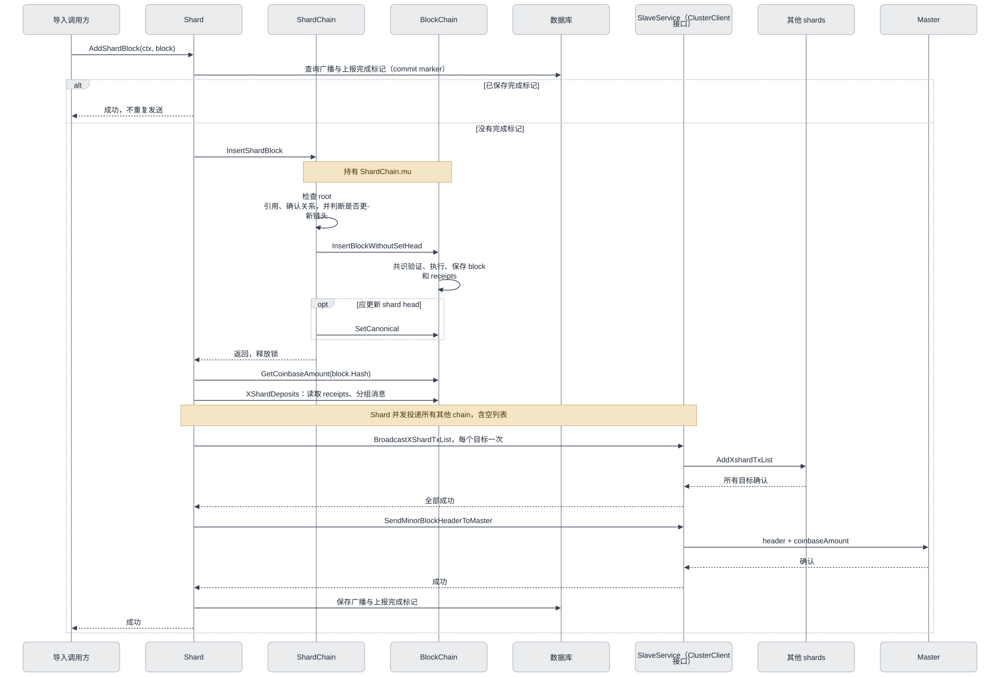

<details>
<summary>Add shard block Mermaid 源码</summary>

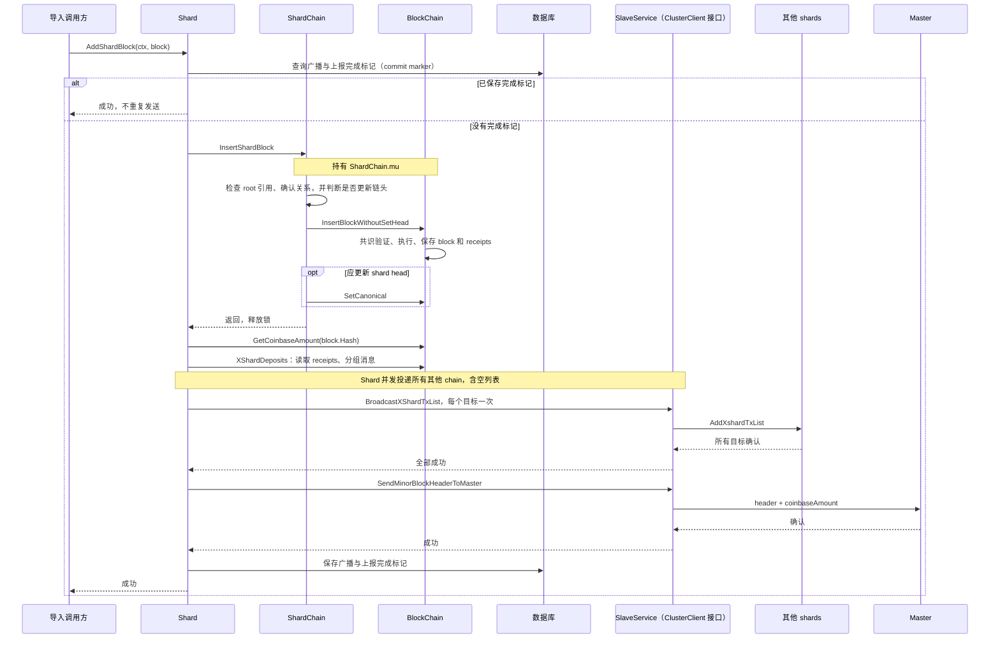

</details>

沿用 [Shard.AddShardBlock:243](../qkc/shard/backend.go) 的顺序和重试规则：任何阶段失败即返回；已入库但没有完成标记的区块仍须重试广播和上报。发送网络 RPC 时已释放 `ShardChain.mu`。区块已入库但上报失败时，链头可能已经前进，重复 SubmitWork 可能会被当作过期 work 拒绝；后续同步/重试需要按区块 hash 补发。

## 7. Add root block：根据 root 更新 shard 链头

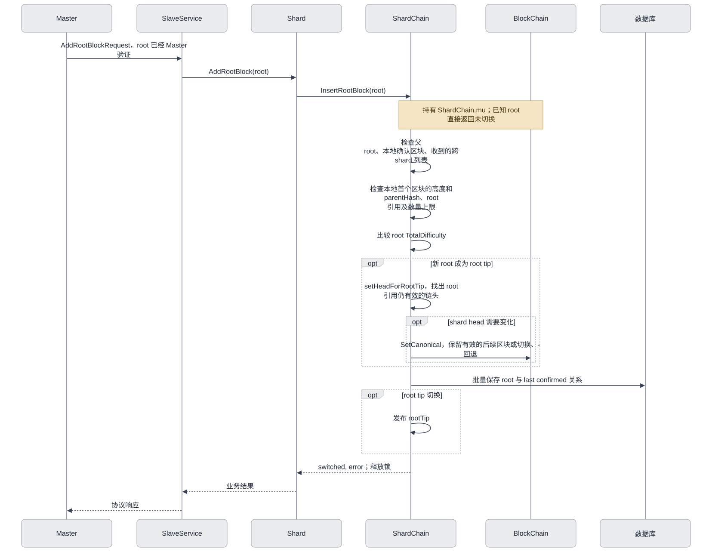

<details>
<summary>Add root block Mermaid 源码</summary>

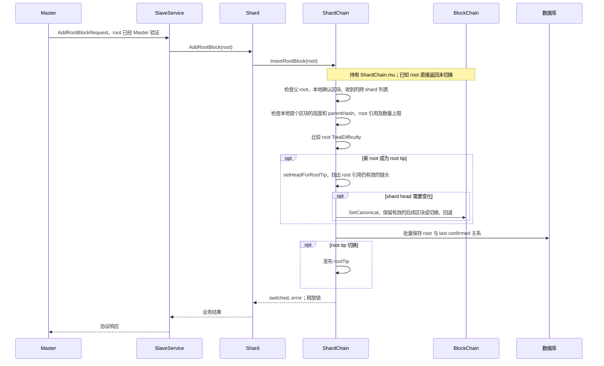

</details>

复用 [ShardChain.InsertRootBlock:461](../qkc/shard/shardchain.go)。缺少本地 block/deposit 列表时返回错误；M2 由同步层补齐后重试。Root 共识验证仍是 Master 的职责。

现有顺序是先更新 shard head，再保存 root batch。前一步成功、后一步写入失败时，链头可能已经改变。这里沿用已有错误返回和恢复方式，不把两步改成一起成功或一起失败。

## 8. 停止任务与关闭资源

Node 调用 `Ethereum.Stop`：

1. Ethereum 标记正在停止，让内部 SlaveService 拒绝新连接和业务请求。
2. 取消请求和任务的 context，停止并等待挖矿；M2 还需停止同步任务。
3. SlaveService 等待已开始的请求处理结束；Ethereum 等待区块构建、导入和发送结束。
4. Ethereum 让 SlaveService 关闭 Master 与跨 shard 连接。
5. Ethereum 关闭交易池、索引、BlockChain 和 PoSW Engine，最后关闭 DB；已经停止的任务直接跳过，资源只关闭一次。

SlaveService 不单独注册到 Node，也不再接收 cmd 传入的停止任务函数。`BaseConn.Close` 不取消或等待已经开始的请求处理函数；SlaveService 必须取消并等待这些请求结束，之后 Ethereum 才能关闭数据库。连接异常需要停止整个 slave 时，请求处理函数发出停机通知后返回，由其他 goroutine 执行 `Node.Close`，避免关闭流程与当前请求互相等待。

## 9. 入口改动清单：仅 QKC 模式

**QKC 链更新请求统一通过 Shard，再由 ShardChain 调用 core 的导入/SetCanonical 方法；其他运行时入口不能绕过 Shard，直接调用 ShardChain 或 BlockChain 导入区块、修改链头。**

| 入口 | 目标行为 | 当前代码位置 |
| --- | --- | --- |
| Engine API：newPayload、forkchoiceUpdated 等 | cmd/geth 的 QKC 分支跳过注册；不能直接导入、选 head 或设 safe/finalized | [catalyst.Register:52](../eth/catalyst/api.go)、[cmd/geth/config.go](../cmd/geth/config.go) |
| 原生 eth/snap downloader、区块导入调用 | M1 不启用，QKC 同步在 M2 实现。若要继续使用它的交易广播功能，需要确保不会同时启用原有区块导入调用 | [downloader.InsertChain 调用:942](../eth/downloader/downloader.go) |
| simulated beacon、beacon light sync、sync override | cmd/geth 的 QKC 分支不启用 | [cmd/geth/config.go](../cmd/geth/config.go)、[eth/syncer/syncer.go](../eth/syncer/syncer.go) |
| debug_setHead / EthAPIBackend.SetHead | 返回不支持；未来维护操作必须遵守 root 约束 | [EthAPIBackend.SetHead:67](../eth/api_backend.go) |
| admin_importChain、普通 CLI import | 支持 QKC 链规则前拒绝执行；不能直接 InsertChain，也不能按 HasBlock 跳过尚未完成的广播和上报 | [AdminAPI.ImportChain:93](../eth/api_admin.go) |
| ResetWithGenesisBlock 等运行时重置 | 禁止直接绕过 root/确认关系执行 | [Ethereum.ResetWithGenesisBlock:438](../eth/backend.go) |
| pending block/state 构建 | 改用 QKC 构建；未实现前返回不可用，不能改用普通 pending 构建 | [EthAPIBackend.Pending:239](../eth/api_backend.go)、[miner.getPending:145](../miner/miner.go) |
| Blob 交易与 blobpool | 当前 PoSW 不支持：不接入 blobpool，并确认交易入口拒绝 BlobTxType | [Ethereum txpool 初始化](../eth/backend.go) |
| safe/finalized RPC 标签 | 尚未确定它们对应哪些 root 确认状态前，返回不支持；不能直接使用 beacon 的 finality 状态 | [EthAPIBackend.HeaderByNumber](../eth/api_backend.go) |

已有 [NodeConfig.Validate](../qkc/config/config.go) 要求 Slave 关闭外部 P2P，但 Ethereum 仍会创建 handler、注册 eth/snap 协议；配置校验不能代替这里的 backend 分支处理。

禁用 handler/downloader 或 blobpool 后，要一起检查调用它们的方法：`Ethereum.APIs/Start/Stop/Protocols`、`Downloader/Synced/SetSynced/BlobFetcher`、`EthAPIBackend.SyncProgress`。**不能只停止注册协议，却继续调用尚未创建的 handler/blobCache 的方法，否则会发生空指针错误。** 普通 block/state 查询、交易提交和日志订阅尽量保留原有调用。

## 10. 具体实施与 review items

以下是模块级工作清单，不代表已实现，也不展开成逐提交执行计划。

### 核心集成工作

- [ ] **W01 · Ethereum 创建组件**：使用已有 `NodeConfig.Eth`，加载并校验实际链配置、核对所选 ChainID。由 `eth.New` 的 QKC 分支创建 SlaveService，调用 `posw.New(chainConfig, genesisHeader)` 创建并持有 PoSW Engine；随后创建单个 BlockChain、legacy txpool 和 builder，将同一实例传给 BlockChain 和 builder；再创建 `NewShardChain`、Shard、PoWMiner。将 SlaveService 作为 ClusterClient 传给 Shard，再绑定 Shard 业务接口。Ethereum 统一启动和关闭，不额外注册 SlaveService Lifecycle。不能沿用仅支持 beacon 的 [CreateConsensusEngine](../eth/ethconfig/config.go) 分支；现有普通 geth 调用继续可用。
- [ ] **W02 · Shard 使用已有组件**：调整 [Shard.New:76](../qkc/shard/backend.go)，接收外部创建的 ShardChain/ClusterClient；移除其中的 `posw.New` 和 BlockChain 创建代码，以及 `Shard.Stop` 中的链、引擎关闭逻辑和仅用于关闭的字段。Shard 若无其他清理工作则删除 `Stop`。同步更新职责注释和 TODO，保留 AddShardBlock 的完成标记、广播、上报与重试顺序。
- [ ] **W03 · 禁止绕过 Shard 的链更新调用**：逐项核对第 9 节。尤其检查调用 handler/Downloader/SyncProgress 的地方、pending 构建和 BlobTxType；验证普通 geth 分支保持原行为。
- [ ] **W04 · 停止顺序与资源关闭**：由 Ethereum 按第 8 节统一执行；等待已开始的请求处理、构建、导入结束后再关资源，Shard 不关闭借用的 ClusterClient。验证构造和启动失败的清理，避免重复关闭或请求处理函数等待自身退出。

### 相关模块的对接要求

- [ ] **W05 · cmd/geth 启动接入**：支持使用 QKC 配置启动，将配置和 Genesis 加载结果交给 Ethereum，复用现有 Node 启动流程；普通 geth 行为保持不变。
- [ ] **W06 · SlaveService**：负责 Master 与跨 shard 通信，实现 `shard.ClusterClient`，将收到的业务请求转发给 Shard。由 Ethereum 创建和管理，完成业务接口绑定后才能开始监听；遵循业务就绪条件，停止时拒绝新请求，取消并等待在途请求结束后，Ethereum 才能关闭链资源。
- [ ] **W07 · Master 连接**：负责与 Master 的连接及双向请求交互，对接 SlaveService，支持初始化、root 区块下发、header 上报和查询等业务；遵循现有连接建立顺序和异常断开时的节点停止策略。
- [ ] **W08 · 远程矿工 API**：扩展现有 MinerAPI，提供 GetWork / SubmitWork，调用 Ethereum 持有的 PoWMiner；未完成 Init、所需连接尚未就绪或正在停止时返回错误，M2 再增加同步就绪检查。

代码和图片使用相对本文位置的仓库内链接，可在 VSCode Markdown 预览和仓库网页中打开；代码行号作为阅读提示，随实现可能变化。图的 Mermaid 源码保留在各节折叠区，修改时同步更新对应 SVG。本文仅记录设计，不修改业务代码、不引入项目依赖。
